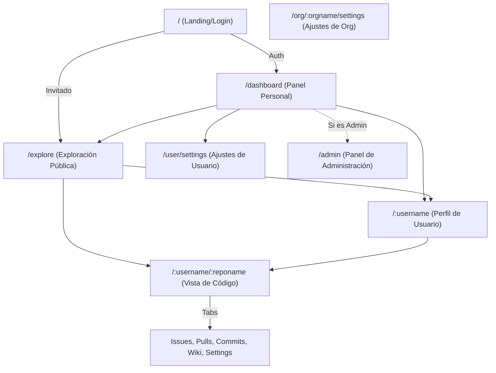

# Estructura de Conexión de Vistas - Ggit

Este documento detalla la jerarquía de navegación y la interconexión entre las diferentes vistas (routes) y componentes del ecosistema **ggit**.

## 1. Mapa de Navegación (Flujo Principal)

## 2. Desglose de Rutas y Componentes

A continuación se detalla qué componentes de `lib/components` inyectan funcionalidad en cada ruta:

### A. Núcleo (Core)
*   **`/`**: Gestiona el acceso. Utiliza `ThemeSelector` y `LanguageSelector`.
*   **`/dashboard`**: Utiliza `DashboardView`, `RepoRow` y `SocialListView`.

### B. Exploración (`/explore`)
*   **`/explore/repos`**: Inyecta `ExploreRepos` y `RepoRow`.
*   **`/explore/users`**: Inyecta `ExploreUsers` y `UserRow`.
*   **`/explore/organizations`**: Inyecta `ExploreOrganizations`.

### C. Repositorio (`/:username/:reponame`)
Esta es la vista más compleja, dividida por pestañas funcionales:
*   **Código**: `RepoFileBrowser` + `MarkdownRenderer` (para el README).
*   **Commits**: `CommitRow` + `DiffViewer`.
*   **Issues/Pulls**: `RepoIssues`, `RepoPulls`, `IssueDetail` y `PullDetail`.
*   **Settings**: `RepoSettingsGeneral`, `RepoSettingsCollaboration`, etc.

### D. Administración (`/admin`)
Utiliza la arquitectura de "Islas Modulares":
*   **Monitor**: `AdminMonitor`.
*   **Usuarios/Orgs**: `AdminUsers`, `AdminOrgs`, `AdminUserEditor`.
*   **Configuración**: `AdminConfig` y `AdminConfigEditor`.

## 3. Puntos de Conexión Global (Navigation.svelte)

El componente `Navigation.svelte` actúa como el orquestador global presente en el `+layout.svelte` raíz, permitiendo saltos directos entre:
1.  **Dashboard** (Home)
2.  **Explore** (Búsqueda global)
3.  **Admin** (Sólo visible para administradores)
4.  **User Dropdown**:
    *   Perfil (`/:username`)
    *   Ajustes (`/user/settings`)
    *   Logout

## 4. Jerarquía de Layouts

SvelteKit utiliza layouts anidados para mantener el estado visual:
1.  **`src/routes/+layout.svelte`**: Carga el Tema, I18n y la `Navigation` global.
2.  **`src/routes/admin/+layout.svelte`**: Añade el sidebar administrativo.
3.  **`src/routes/[username]/[reponame]/+layout.svelte`**: Añade la cabecera del repositorio (`ViewHeader`) y las pestañas (Code, Issues...).
